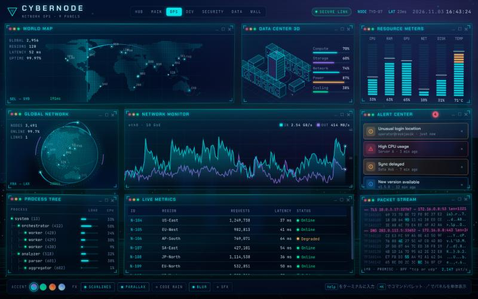
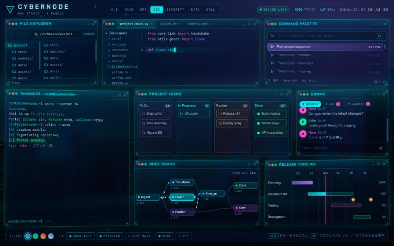
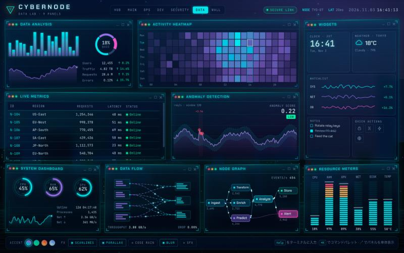

# Cybernode HUD

ハッカーごっこ用のホログラム UI 集。HTML / CSS / Canvas だけで動き、ビルドもライブラリも不要です。
28 枚のパネルを、まとめて眺める「ビュー」と、1 枚だけを大きく映す「単体ページ」で開けます。

**https://yasut0ra.github.io/cybernode-hud/**


| Network Ops | Dev Studio | Data Lab |
| --- | --- | --- |
|  |  |  |

## ページ

| URL | 内容 |
| --- | --- |
| `index.html` | ハブ。ビューとパネルの一覧から選んで開く |
| `view.html#main` | Main Console。最初に作った 10 パネルの構成 |
| `view.html#ops` | Network Ops。世界地図・データセンター・トラフィック・アラート |
| `view.html#dev` | Dev Studio。エディタ・ターミナル・ファイル・コマンドパレット・カンバン・チャット |
| `view.html#sec` | Security Center。ロック解除・認証・スキャン・異常検知・脅威マップ |
| `view.html#data` | Data Lab。ヒートマップ・ライブ表・パイプライン・ウィジェット |
| `view.html#wall` | The Wall。全 28 パネルを 1 ページに敷き詰めたスクロール用 |
| `view.html#<panel>` | 単体ページ。例: `view.html#globe`、`view.html#term` |

各パネル右上の ↗ から、そのパネルの単体ページを新しいタブで開けます。

## VR ゴーグルで使う

- Quest などのブラウザでウィンドウを 3 枚並べ、正面に `#main`、左右に `#ops` と `#dev` や `#sec` を開くと囲まれ感が出ます
- 単体ページはパネル 1 枚が画面いっぱいに広がるので、ターミナルや地球儀を大きく映すのに向いています
- 重いときは画面下のバーで **BLUR**（ガラスのぼかし）を OFF にすると描画がかなり軽くなります
- 設定（アクセント色・エフェクト）はブラウザに保存され、全ページで共有されます

## パネル

| グループ | パネル |
| --- | --- |
| Network | Global Network（地球儀）· World Map · Network Monitor · Data Center 3D · Alert Center |
| Security | Security Core · Authentication · Target Analysis · Anomaly Detection · Packet Stream |
| Develop | Editor · Terminal · File Explorer · Command Palette · Project Tasks（カンバン）· Comms（チャット）· Release Timeline |
| Data | Data Analysis · Activity Heatmap · Live Metrics · Data Flow · Node Graph |
| System | Workspace（ナビ）· System Dashboard · Resource Meters · Process Tree · Widgets · Settings |

## 操作

- **ターミナル**: `help` `scan` `trace <city>` `decrypt` `breach` `theme <name>` `matrix` `glitch` `open <view|panel>` `ls` など。↑↓ で履歴、Tab で補完
- **コマンドパレット**: `⌘K` / `Ctrl+K` で呼び出し。ビュー移動・テーマ変更・演出を実行できる
- **チャット**: 話しかけるとボットが返事をする。「breach」「trace」「rain」などに反応
- **ロック**: Security Core のロックをクリックで解錠シーケンス → ACCESS GRANTED
- **地球儀**: ドラッグで回転
- **カンバン**: カードは自動で進むほか、ドラッグでも移動できる
- **ライブ表**: 見出しクリックで並び替え

`prefers-reduced-motion` が有効な環境では動きを止めて表示します。

## 構成

```
index.html        ハブ
view.html         ビュー / 単体ページ（#ハッシュで切り替え）
css/hud.css       見た目すべて（色は :root の CSS 変数）
js/core.js        テーマ・設定・背景・オーバーレイ・パネル登録・ビュー定義・起動
js/geo.js         大陸の輪郭データと都市
js/p-classic.js   最初からあるパネル
js/p-ops.js       ネットワーク系パネル
js/p-dev.js       開発系パネル
js/p-data.js      データ・認証・設定・ウィジェット
```

パネルは `HUD.def('名前', { title, group, desc, build(pb, el) { … } })` で登録します。
ビューの並びは `js/core.js` の `VIEWS` に `[パネル名, 横幅(12分割), 高さ(行数), タブレット幅(6分割)]` で書きます。
パネル同士は `HUD.emit('trace', 'LON')` のようなイベントでつながっています（`trace` `scan` `breach` `open-file` など）。

ローカルでは `index.html` をブラウザで開くだけで動きます。
