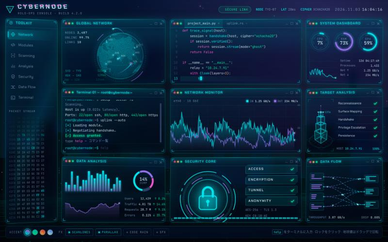

# Cybernode HUD

ホログラム風の「ハッカーっぽい」コンソール UI。HTML / CSS / Canvas だけで動く 1 ファイル構成で、ビルドもライブラリも不要です。



## 動かし方

`index.html` をブラウザで開くだけです（フォントは Google Fonts から読み込みます）。

```bash
open index.html
```

## パネル

| パネル | 内容 |
| --- | --- |
| Global Network | ドットで描いた地球儀が自転し、都市間を光の弧が走る。ドラッグで回転 |
| コードエディタ | Python / Rust のコードがシンタックスハイライト付きでタイピングされる |
| System Dashboard | CPU・RAM・GPU のリングゲージ、スパークライン、稼働時間 |
| Terminal | 起動デモのあと、コマンドを入力できる |
| Network Monitor | IN / OUT の波形がリアルタイムで流れる |
| Target Analysis | 回転するワイヤーフレームのビルを走査線がスキャンし、チェックリストが進む |
| Data Analysis | 棒グラフ、ドーナツ、エリアチャート、KPI |
| Security Core | 回転リングのロック。クリックで解錠シーケンスと全画面の ACCESS GRANTED |
| Data Flow | ベジェ曲線の上をパケットが流れる |

## ターミナルのコマンド

| コマンド | 動作 |
| --- | --- |
| `help` | コマンド一覧 |
| `scan` | ターゲットを再スキャン |
| `trace <city>` | 東京から都市への回線を地球儀に描く（`lon` `nyc` `sfo` `syd` など） |
| `decrypt` | 暗号メッセージを解読 |
| `breach` | アクセスシーケンスを実行 |
| `theme <name>` | アクセント色を変更（`neon` `phosphor` `amber` `ice`） |
| `matrix` | コードレインの ON / OFF |
| `glitch` | 画面グリッチ |
| `whoami` `ls` `date` `clear` | おまけ |

↑↓ で履歴、Tab で補完。

## 演出

- パネルは 1 本の線からホログラムのように展開して出現する
- パネル全体が手前に湾曲した壁のように並び、マウスに合わせて傾く（視差）。ホバーで浮き上がる
- 背景は窓の灯る街並み、流れる床グリッド、漂う光の粒
- 画面下のバーでアクセント色と、走査線・視差・コードレイン・効果音を切り替え（設定はブラウザに保存）
- `prefers-reduced-motion` が有効な環境では動きを止めて表示する

## カスタマイズ

色はすべて `:root` の CSS 変数（`--a1` `--a2` `--a3` など）から決まります。テーマを増やすときは `:root[data-accent="名前"]` ブロックを追加し、スクリプト内の `ACCENTS` 配列とドックのボタンに名前を足してください。

各パネルは `<section class="panel">` と、スクリプト内の対応する `draw*` / `update*` 関数のセットになっているので、気に入ったパネルだけ切り出して別のページに流用できます。
